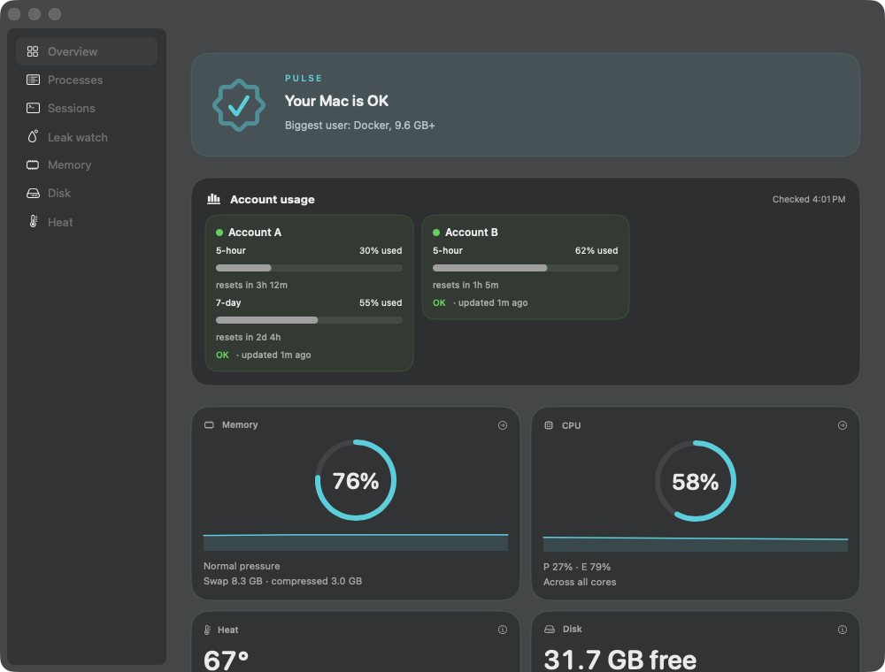
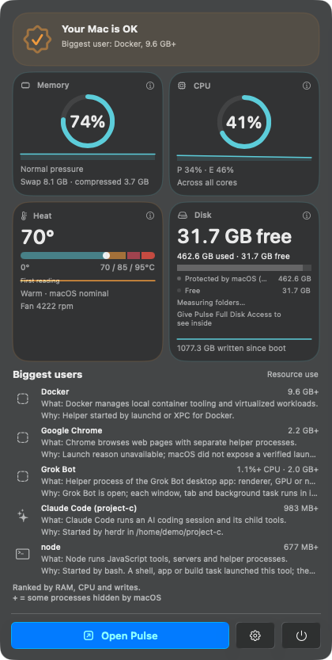
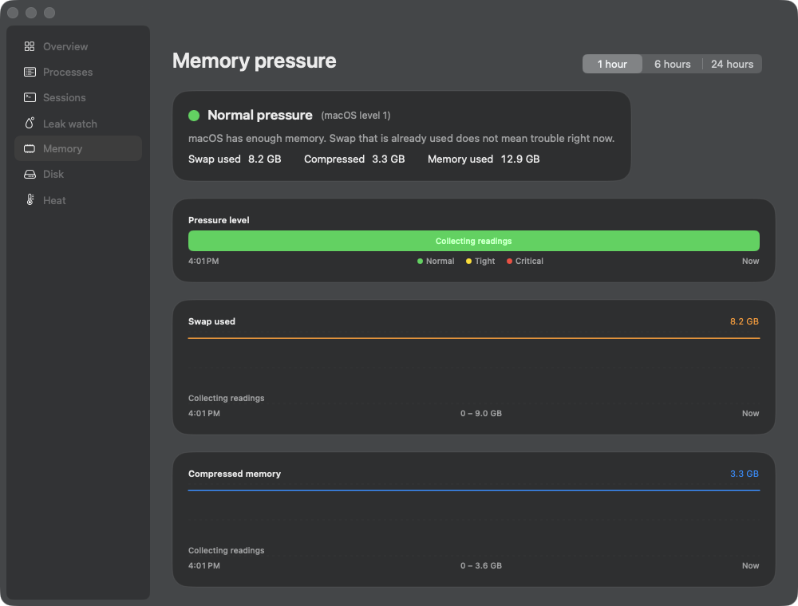

# Pulse

Pulse is a lightweight macOS menu-bar monitor for memory, CPU, disk space, heat,
and the apps and process groups using resources. Overview provides grouped process
drill-downs by Memory or CPU, with a minute of history for the top 12 owners.
Expanded rows explain what each owner does and why it is running when that is known.
Memory groups show summed physical footprint (Activity Monitor's Memory column). RSS is a secondary detail. Shared pages can still be counted more than once.







## Build and run

Requirements: macOS 26, Swift 6.2 or newer (Xcode or the Command Line Tools), and `python3` (the icon script). `scripts/check.sh` stops when free memory is under 10%.
This tree was checked with Swift 6.2.1 (`swiftlang-6.2.1.4.8`), target `arm64-apple-macosx26.0`.

```sh
git clone <this-repo-url> pulse-monitor
cd pulse-monitor
swift build -c release
scripts/test.sh          # preferred; wraps swift test with Swift Testing framework search paths
# Equivalent: scripts/check.sh test
# On a full Xcode install you can also run: swift test --disable-xctest --enable-swift-testing
scripts/check.sh build
scripts/bundle.sh
open build/Pulse.app
```

`scripts/bundle.sh` builds the `.app` bundle and signs ad-hoc unless you pass a certificate that is already
installed: `SIGN_IDENTITY='your certificate name' scripts/bundle.sh` or
`scripts/bundle.sh --sign-identity 'your certificate name'`.
Optional gitignored `scripts/local.env` can export `SIGN_IDENTITY`.
`PULSE_ADHOC=1` ignores that file. See [signing](docs/SIGNING.md).

Ad-hoc signing is enough for local use. This repository does **not** provide notarized binaries.

Full Disk Access is optional. It only deepens the disk breakdown. On launch, if
Pulse cannot open `~/Library/Application Support/com.apple.TCC/TCC.db`, it shows
one dismissible prompt: Open Settings
(`x-apple.systempreferences:com.apple.preference.security?Privacy_AllFiles`),
Don't ask again, or Not now. Pulse cannot grant the permission itself. In
System Settings the app is named Pulse. An ad-hoc rebuild changes the code
hash, so the grant may have to be turned on again. A stable signing identity
keeps it.

Known limits:

- Memory rows are summed physical footprint, the same figure as Activity Monitor's Memory column. RSS is a secondary detail. Shared pages can be counted more than once.
- A virtual machine helper such as "Virtual Machine Service for Docker" is included in the owning app.
- Processes running as root or another user, including DriverKit, show "needs admin" when Pulse cannot read them.
- The runway card can treat one large file drop as a steady fill rate. Read it as a prompt to look, not a forecast.
- Compressed memory in the memory section is the system compressor, not part of an app's total.
- History, leak watch, and the timeline stay in memory and reset on quit.

## Privacy and optional integrations

Core readings and history stay local. Pulse makes no network requests and changes no
permissions. Full Disk Access is optional, as described above. Protected folders remain unmeasured without it; symlinks are skipped.
Disk totals are allocated-byte estimates, not an exact reconciliation of APFS sharing.
Progress is saved in `~/Library/Application Support/Pulse/disk-cache.json`.
Optional `config.json` beside it accepts `{"extraRoots":["~/work"]}`.

Three integrations are optional and auto-detected. When absent, their sections stay hidden and no errors are shown:

| Provider | Detected when | UI |
|---|---|---|
| `herdr` | `herdr` is executable on `PATH` or in `/opt/homebrew/bin`, `/usr/local/bin`, `~/.local/bin`, `~/.cargo/bin` | Session pane labels |
| `agent-accounts` | `~/.claude` or `~/.codex` exists under the provider home | Account folder labels on AI sessions |
| `usage-strip` | An executable usage reader is found (see below) | Account usage strip on Overview |

Defaults search the real user home and `PATH`. Finder / LaunchServices launches inherit a minimal `PATH`, so the fixed install folders above are always checked unless you override detection.

Environment overrides (nothing is moved; detection only):

- `PULSE_PROVIDER_HOME` — absolute directory used instead of the user home for account and usage detection
- `PULSE_PROVIDER_PATH` — absolute `PATH`-style string used instead of process `PATH` for `herdr` (disables the fixed install-folder fallbacks)
- `PULSE_USAGE_EXECUTABLE` — absolute path to a usage reader; otherwise `<provider home>/bin/usage`

Example with all optional sections forced off:

```sh
PULSE_PROVIDER_HOME=/nonexistent PULSE_PROVIDER_PATH=/usr/bin build/Pulse.app/Contents/MacOS/Pulse --show-window
```

`PULSE_DEMO=1` feeds generic sample session labels and usage text for local README screenshots. Leave it unset for normal use. Point providers at a temp fixture when you also want to hide live integrations:

```sh
PULSE_DEMO=1 PULSE_PROVIDER_HOME=/tmp/pulse-demo-fixture PULSE_PROVIDER_PATH=/tmp/pulse-demo-fixture/bin \
  PULSE_USAGE_EXECUTABLE=/tmp/pulse-demo-fixture/bin/usage \
  build/Pulse-demo.app/Contents/MacOS/Pulse --show-window
```

The usage strip runs your own reader with `--swiftbar` while the window is open (at most once a minute, with a timeout) and never stores its output or keys. That tool may contact its providers; Pulse does not.
See [architecture and provider boundaries](docs/ARCHITECTURE.md).

Run `scripts/test.sh` (or `swift test`) for executable checks. [Disk contracts](docs/disk/README.md)
describe local checks vs desktop proof.
The orchestrator can open `build/Pulse.app/Contents/MacOS/Pulse --show-window --show-drilldown memory`
(or `cpu`) for desktop checks. `--disk-bench` prints real headless scan measurements.

## Features

Six local, read-only views beyond the core vitals:

| View | What it shows |
|---|---|
| Sessions | Every running Claude Code / Codex session: account folder, multiplexer pane (when a pane provider is installed), working folder, uptime, combined memory and CPU of the session and its child tools |
| Leak watch | Owners whose memory climbs steadily for 10+ minutes, with MB/hour and a plain-English explanation |
| Memory | Pressure level (green/yellow/red), swap used and compressed memory for 1, 6 or 24 hours |
| Disk | Adds a runway card: free space, fill rate and "full in about N days" (or "stable") |
| Heat | Thermal state, CPU speed limit, thermal warning level and a throttling-event timeline |
| Overview | Account usage strip (only when a usage reader is detected) |

Build beside an installed Pulse without any certificate (ad-hoc signing, separate bundle id):

```sh
scripts/check.sh build
PULSE_ADHOC=1 PULSE_OUTPUT=build/Pulse-v7.app PULSE_BUNDLE_ID=local.pulse.monitor.v7 PULSE_VERSION=0.7.0 scripts/bundle.sh
open build/Pulse-v7.app
```

Demo screenshot bundle (does not replace `/Applications/Pulse.app`):

```sh
scripts/check.sh build
PULSE_ADHOC=1 PULSE_OUTPUT=build/Pulse-demo.app PULSE_BUNDLE_ID=local.pulse.monitor.demo PULSE_VERSION=0.1.0-demo scripts/bundle.sh
PULSE_DEMO=1 build/Pulse-demo.app/Contents/MacOS/Pulse --show-window
```

`PULSE_ADHOC=1` ignores `scripts/local.env`. Open a view directly with `--show-window --show-section sessions|leaks|memory|disk|heat`.

Optional providers are detected at launch and re-checked every 15 minutes (agent environments are read only if an agent integration was found at launch, so relaunch after installing one).

Privacy: Pulse itself makes no network requests. Timelines, leak history and throttling events live in memory only
(24 hours at 30-second steps, fixed size) and vanish on quit. Agent account and pane come from two or three named
variables of your own processes (`CLAUDE_CONFIG_DIR`, `CODEX_HOME`, `HERDR_PANE_ID`); no other variable is read or kept.
Pulse never signals, quits or attaches to any process.

Closed-window cost: owners are refreshed every 30 seconds (6 seconds while a window is open) so leak watch has history.

License: MIT. Copyright (c) 2026 Daniel Sardina. See [LICENSE](LICENSE).
